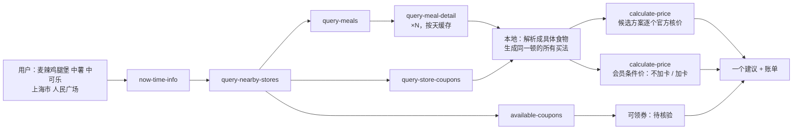

# MCP_INTEGRATION · 麦麦参谋如何使用麦当劳 MCP

## 1. 使用的 MCP Server
| 项目 | 值 |
|---|---|
| Server | 麦当劳中国官方 MCP（`mcd-mcp`） |
| 地址 | `https://mcp.mcd.cn`（Streamable HTTP，无会话状态） |
| 鉴权 | 请求头 `Authorization: Bearer ${MCD_MCP_TOKEN}`；Token 只放在本机 `~/.config/mcd-advisor/.env`，不进仓库；装在 WorkBuddy 里时，没配 `.env` 就只读复用 WorkBuddy 里已配好的麦当劳连接器（`~/.workbuddy/mcp.json` 中地址为 `https://mcp.mcd.cn` 的那一个） |
| 配置示例 | [`mcp-config.example.json`](mcp-config.example.json)（只含环境变量占位符） |
| 接入方式 | `src/mcp.mjs` 直接按 JSON-RPC 调用 `tools/call`；价格从返回文本里的原始 JSON 读取，**不经过大模型**。装在 WorkBuddy 等 AI 助手里也一样：助手只运行脚本，脚本直连官方 MCP、只调白名单里的工具 |

## 2. 用到的 8 个工具（线上共 35 个）
| 工具 | 读 / 写 | 在本项目里做什么 |
|---|---|---|
| `now-time-info` | 读 | 拿服务器时间，判断餐段，并标在账单上 |
| `query-nearby-stores` | 读 | 按「城市 + 地标」或收藏门店找店（`beType=1` 到店） |
| `query-meals` | 读 | 当前门店在售菜单：名称、现价、原价、`discountType`（区分促销价和会员条件价）、`withOrder`（随单购卡参数） |
| `query-meal-detail` | 读 | 套餐、随心配、单品的组成（rounds / choices / 差价），用来判断「同一顿」能怎么组合 |
| `query-store-coupons` | 读 | 这家店此刻能用的券（券号 + 适用商品），一单最多挂 1 张 |
| `available-coupons` | 读 | 麦麦省可领券（只有标题），只标为「待核验」 |
| `calculate-price` | 读 | **唯一的价格依据**。每个候选方案、会员条件价（不加卡 / 加卡）都送官方核价，返回价格（分）、逐行小计、`traceId` |
| `auto-bind-coupons` | **写** | 仅在用户加 `--claim` 并在终端亲手输入 y 后调用；领取前明确说明会一次领取全部可领券 |

工具调用有**白名单**（`src/mcp.mjs`）：只读的 7 个默认可用；写工具只有 `auto-bind-coupons`，并且必须显式开启。下单、取消、抽奖、积分兑换等工具即使被要求也发不出去（有单元测试覆盖）。

### 没用的 27 个，以及原因
| 工具 | 原因 |
|---|---|
| `create-order` `cancel-order` `query-order` `order-list` | 本项目只做「怎么买更合适」，不下单；只读、不碰订单更让人放心 |
| `delivery-*`（3 个） | 第一版只做到店；外送菜单、编码和配送费不同，后续再做 |
| `query-my-coupons` | 卡包里的券不一定能在这家店用，真正能核价的只有 `query-store-coupons` |
| `list-nutrition-foods` `campaign-calendar` | 与「同一顿怎么买」无关 |
| `query-my-account` `mall-*`（5 个）`query-lottery-info` `draw-lottery` `query-my-prizes` | 积分、商城、抽奖属于另一个场景，并且会消耗积分 |
| `query-party-*`（4 个）`party-order-create` `query-meal-assistance` `query-promotions` | 派对和企业团餐场景（`query-promotions` 仅团餐可用） |
| `query-survey-coupon` | 订单满意度奖券，与本场景无关 |

## 3. 调用流程

1. 找店，拿当前在售菜单和每个商品的组成（详情按「门店 + 日期」缓存，第二次查询约 1–2 秒）。
2. 把用户说的话解析成具体食物（例如「中薯」=「中薯条」，「中可乐」=「可乐中杯」），说不清的先问。
3. 枚举「同一顿」的买法：分开点、套餐（含官方允许的换品和差价）、随心配 1+1、多个套餐组合、门店券。凡是会多出食物的组合一律排除；「任选 3 份」的格子按份数填；对剩余食物做动态规划，份数多也能找到估算最省的组合；「学生专享」等有资格限制的商品不参与。
4. 按菜单价粗排，取前几名送 `calculate-price` 官方核价；只有核价成功的方案参与排名。
5. 对比菜单上更便宜、但要「随单购会员卡」才成立的商品，分别核价「不加卡」和「加卡（含卡费）」，只做解释。
6. 输出一个建议、省了多少、相关提醒和可核对的账单（门店、时间、逐行小计、`traceId`）。

## 4. 业务价值
- **对用户**：不用自己在套餐、随心配、券、会员价之间来回比；想吃的不变，价格是官方当场报的，并且说明为什么。
- **对麦当劳**：把菜单上复杂的优惠讲清楚，减少「标价 ¥28、结账 ¥57」带来的误解和客诉；帮用户找到合适的套餐或随心配，提升下单意愿和满意度。
- **对开发者**：展示一种可靠的 MCP 用法：模型只负责理解需求，价格全部来自官方工具，可复现、可离线测试。

## 5. 实测记录（2026-10-21，上海黄浦华旭国际大厦餐厅，只读）
| 发现 | 数据 |
|---|---|
| 同一顿：麦辣鸡腿汉堡 + 中薯条 + 可乐中杯 | 分开点 ¥46.0 → 麦辣鸡腿汉堡三件套 ¥33.5 |
| 同一顿：麦香鸡 + 可乐中杯 | 分开点 ¥27.0 → 随心配 1+1 ¥13.9 |
| 只要一个麦辣鸡腿汉堡 | ¥22.5，保持原点法（不推套餐） |
| 菜单显示 ¥28 的四件套（人气超值四件套随心选、麦辣鸡腿堡四件套） | 不加卡核价 ¥57.0；加「麦金卡体验卡（15天）¥9.9」后 ¥37.9；且比上面多一份麦乐鸡4块 |
| 这家店菜单里的「随单购麦金卡」条件价 | 19 个商品 |

以上数字都来自一次真实查询，只代表那家店那个时间的报价，不是全国统一价。

## 6. 踩过的坑（都已在代码里处理）
- 每个工具的返回都是 Markdown，原始 JSON 在 `Original Response` 之后，后面还可能跟着别的文字：需要按括号配对截取 JSON，不能直接 `JSON.parse`。
- 并发稍高时，官方会返回 HTTP 200 加「太火爆了，请稍后再试」：按业务错误识别并退避重试（`src/mcp.mjs`）。
- `calculate-price` 价格单位是**分**，菜单价是**元**的字符串，差价是 `"+ ¥1.5"` 这样的文本。
- 套餐换品通过 `roundList: [{ round: "<round id>", comboItemList: [{ code, quantity }] }]` 传入；只传要换的那一格也可以，其余格保持默认。
- 单点可乐是「带一格选择」的商品：默认是小杯，要中杯必须用 `roundList` 选 `可乐中杯`。只比「套餐 vs 单点默认」会把小杯当中杯比，结果是错的。
- 「随单购」商品的菜单现价不是你能直接付的价：不传 `withOrder` 时官方按原价核价；传入后会自动加上体验卡并计入卡费。
- `available-coupons` 只返回 Markdown（标题、状态、图片），没有券号；`auto-bind-coupons` 一次领取全部。
- `query-meal-detail` 里一个格子可能要 2–3 份（`quantity`/`minQuantity` 大于 1，例如「任选 3 份小食」），每个选项还有各自的上限（`maxQuantity`）。按一份处理会把「7 件任选」当成 3 样东西，`comboItemList` 里要传真实份数。
- 单个商品详情偶尔会查询失败：不要把失败结果缓存，也不要猜它的组成，这次直接不参与比较，下次再取。
